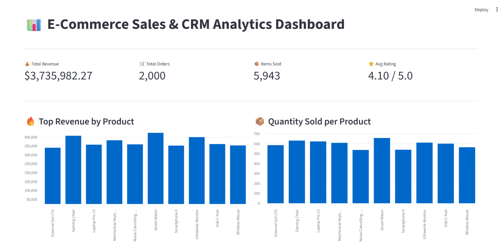
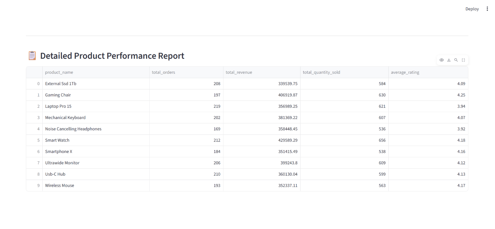

# 🛒 E-Commerce Data Engineering & Analytics Project

An end-to-end data engineering and analytics project that involves extracting data from multiple sources (PostgreSQL & MongoDB), transforming it, and loading it into a production-ready **Star Schema Data Warehouse** on PostgreSQL. The project also includes an interactive analytics dashboard built with Streamlit.

---

## 🏗️ Architecture & Database Design

The project follows a robust Star Schema design to optimize analytical queries and reporting:
* **Dimension Tables**: `dim_customers`, `dim_products`
* **Fact Table**: `fact_sales`

---

## 📊 Analytics Dashboard (Streamlit)

### 1. Executive Overview & KPIs
The dashboard provides high-level business metrics including Total Revenue, Total Orders, Items Sold, and Average Rating, alongside top-performing product charts.

### 2. Detailed Product Performance Report
A comprehensive data grid showcasing granular metrics per product (orders, revenue, quantity sold).

---

## 🛠️ Tech Stack
* **Database & Warehouse**: PostgreSQL, MongoDB
* **ETL & Processing**: Pure SQL, Python (Pandas/NumPy for pipeline support)
* **Visualization & UI**: Streamlit
* **Version Control**: Git & GitHub
*
